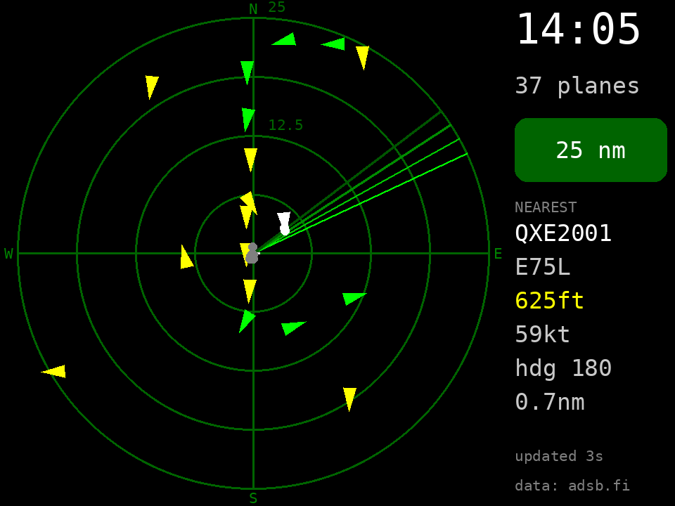

# CYD plane tracker

A live radar of the aircraft around you on the ELEGOO CYD 2.8" ESP32-32E (E32R28T). It uses
free ADS-B data from [adsb.fi](https://adsb.fi), so you don't need an antenna or an API key.



*Approximate preview drawn from a real adsb.fi response (with desktop fonts), not a photo of the board.*

- **Radar (left):** you're at the centre, north is up, and the rings mark ¼ to 1 of the range. A
  green sweep goes round every few seconds, and each plane flashes white as it passes.
- **Planes:** an arrow shows the plane's heading. A dot means it's on the ground or its heading
  is unknown. Callsigns are shown when there are 20 or fewer planes.
  - Colour shows altitude: yellow below 5,000 ft, green below 20,000 ft, cyan above that, and
    grey on the ground.
- **Panel (right):** shows the clock, how many planes are in range, and a **range button** you
  tap to cycle 5 / 10 / 25 / 50 nm. Below that is a card for the nearest airborne plane, or
  the one you tapped, with callsign, type, altitude (^ climbing / v descending), speed,
  heading and distance.
- **Tap a plane** to select it, and tap empty sky to clear the selection.

It refreshes every 10 s in a background task, so the animation never freezes while it waits on
the network.

## Set up

1. **Configure.** Copy `include/config.example.h` to `include/config.h` and fill it in:
   - your **2.4 GHz** Wi-Fi name and password (the ESP32 can't use 5 GHz)
   - your latitude and longitude (right-click your house in Google Maps to copy them)
   - your timezone, picked from the examples in the file

   `config.h` is git-ignored, so your password and home location never get committed.
2. **Build and flash.** Same as the touch demo (see `../cyd-touch-demo/README.md` for Mac setup):
   ```bash
   cd cyd-plane-tracker
   pio run -t upload -t monitor
   ```
3. Watch the serial monitor. After `Wi-Fi connected, IP …` you should see a line like
   `Fetched 37 planes within 25 nm in 900 ms, free heap 110000` every 10 seconds.

If you already calibrated touch in `cyd-touch-demo`, this project uses the same calibration.
To redo it, hold a finger on the "Plane Tracker" splash screen.

## Troubleshooting

| Panel / serial shows | Meaning | Fix |
|---|---|---|
| `No Wi-Fi` | can't join the network | check SSID/password, and that it's 2.4 GHz |
| `connection refused` / `HTTP -1` | TLS or network failure | the clock must be set first, so wait ~10 s after boot. Check that `opendata.adsb.fi` isn't blocked on your network |
| `HTTP 429` | too many requests | raise `REFRESH_SECONDS` |
| `Bad response` | the reply was cut off or malformed | usually weak Wi-Fi; it retries automatically |
| 0 planes for a long time | nothing nearby, or no receivers in your area | try 50 nm, or compare with the map at [adsb.fi](https://adsb.fi) |
| `Out of memory` on screen | radar buffer couldn't be allocated | shouldn't happen on this board; report the serial log |

Display or touch problems (blank screen, wrong colours, taps in the wrong place) have the same
causes and fixes as in `../cyd-touch-demo/README.md`.

## How it works

- **Data:** `GET https://opendata.adsb.fi/api/v2/lat/{lat}/lon/{lon}/dist/{nm}` returns
  ADS-B Exchange v2-style JSON. It includes each plane's distance (`dst`, nm) and bearing
  (`dir`, degrees) from your point, so placing planes on the radar needs no map maths.
- **Memory:** the response is parsed one aircraft at a time as it streams in, with only the
  needed fields kept. Memory use stays flat however busy the sky is, and the closest 80 aircraft
  are kept.
- **HTTPS:** connections are verified against Google Trust Services' root certificates in
  `include/certs.h`, which are valid until 2036. If adsb.fi changes certificate provider and
  fetches start failing with TLS errors, those certificates need updating.
- **Drawing:** the radar is drawn into an 8-bit off-screen buffer (57 KB) and pushed to the
  screen in one go, which avoids flicker. The panel is redrawn about once a second.

## Data terms

adsb.fi open data is free for **personal, non-commercial use**, and they ask for attribution,
which is why the screen shows "data: adsb.fi". See their
[terms](https://github.com/adsbfi/opendata/blob/main/README.md). The service has no uptime
guarantee, so treat this as a toy, not a safety tool.
